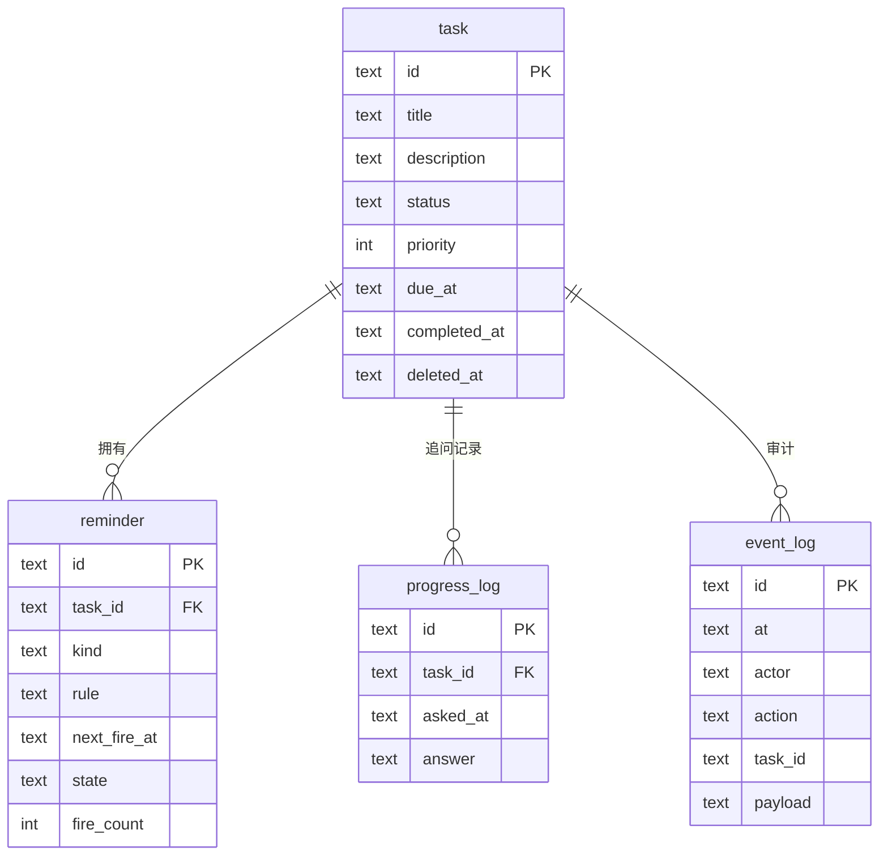

# Whale Reminder · 数据模型与 MCP 工具契约

> 版本 v0.1 · 2026-11-11
> 这份文档是 **GUI、调度器、MCP Server 三方共用的唯一事实来源**。任何一方不得绕过它直接读写数据库。

---

## 1. 全局约定

| 约定 | 规则 | 原因 |
|---|---|---|
| **时间存储** | 一律 UTC，ISO 8601 带 `Z` 后缀（`2026-11-12T02:00:00Z`） | 跨夏令时/时区安全；排序即字符串排序 |
| **时间展示** | 仅在前端渲染时转本地时区 | 存储层不掺时区逻辑 |
| **主键** | UUID v7（时间有序） | `ORDER BY id` 等价于按创建时间排序 |
| **删除** | 软删除，写 `deleted_at` | AI 误删可恢复；查询默认过滤 |
| **并发** | SQLite WAL + `busy_timeout=5000` | GUI 与 MCP 双进程同时读写 |
| **事务** | 只包 SQL，不包网络/UI 调用 | 避免长时间持有写锁阻塞另一进程 |

---

## 2. 实体关系



---

## 3. 表结构 DDL

### 3.1 `task`

```sql
CREATE TABLE task (
  id            TEXT PRIMARY KEY,
  title         TEXT    NOT NULL,
  description   TEXT    NOT NULL DEFAULT '',
  status        TEXT    NOT NULL DEFAULT 'todo'
                  CHECK (status IN ('todo','doing','done','archived')),
  priority      INTEGER NOT NULL DEFAULT 1
                  CHECK (priority BETWEEN 0 AND 3),
  due_at        TEXT,
  started_at    TEXT,
  completed_at  TEXT,
  estimate_min  INTEGER,
  tags          TEXT    NOT NULL DEFAULT '[]',
  source        TEXT    NOT NULL DEFAULT 'manual'
                  CHECK (source IN ('manual','ai','import')),
  created_at    TEXT    NOT NULL,
  updated_at    TEXT    NOT NULL,
  deleted_at    TEXT
);

CREATE INDEX idx_task_live_due ON task(deleted_at, status, due_at);
CREATE INDEX idx_task_status   ON task(status) WHERE deleted_at IS NULL;
```

**字段语义**

| 字段 | 说明 |
|---|---|
| `status` | `todo` 待办 / `doing` 进行中 / `done` 完成 / `archived` 归档（用户主动收纳，不算完成） |
| `priority` | `0` 低 / `1` 普通（默认）/ `2` 高 / `3` 紧急。只影响排序与视觉，不影响提醒时机 |
| `due_at` | 截止时间。**为空表示"没有 deadline"，追问策略会走另一条分支** |
| `started_at` | 用户第一次回答"进行中"时写入，用于计算追问节奏 |
| `estimate_min` | 预估分钟数，用于在气泡里显示"还差 25 分钟" |
| `tags` | JSON 数组字符串，如 `["工作","周报"]` |
| `source` | `ai` 来源的任务在面板上有小标记，便于用户识别"这是 AI 帮我记的" |

> **注意 `archived` 与 `done` 的区别**：用户放弃某件事时不该记为"完成"，否则统计失真。归档不参与逾期计算。

### 3.2 `reminder`

```sql
CREATE TABLE reminder (
  id             TEXT PRIMARY KEY,
  task_id        TEXT    NOT NULL REFERENCES task(id) ON DELETE CASCADE,
  kind           TEXT    NOT NULL CHECK (kind IN ('notify','ask')),
  rule           TEXT    NOT NULL DEFAULT '{"type":"once"}',
  next_fire_at   TEXT    NOT NULL,
  state          TEXT    NOT NULL DEFAULT 'pending'
                   CHECK (state IN ('pending','paused','done','cancelled')),
  fire_count     INTEGER NOT NULL DEFAULT 0,
  last_fired_at  TEXT,
  created_at     TEXT    NOT NULL
);

CREATE INDEX idx_reminder_due  ON reminder(state, next_fire_at);
CREATE INDEX idx_reminder_task ON reminder(task_id);
```

**`rule` 的四种形态**

```jsonc
// 一次性：next_fire_at 就是触发时刻
{"type": "once"}

// 相对截止时间偏移（秒），用于"提前 30 分钟 / 10 分钟 / 2 分钟"三连提醒
{"type": "offset", "offsets": [-1800, -600, -120]}

// 固定间隔重复，用于"每小时问一次进度"
{"type": "interval", "every": 3600, "until": "2026-11-13T00:00:00Z"}

// 每天固定时刻，用于"逾期后每天 09:30 追问"
{"type": "daily", "at": "09:30", "tz": "Asia/Shanghai"}
```

> `offset` 与 `daily` 的 `next_fire_at` 由 `scheduler::compute_next()` 计算并写回。**触发后必须重新计算并更新 `next_fire_at`，否则会无限重复触发。**

### 3.3 `progress_log`

```sql
CREATE TABLE progress_log (
  id           TEXT PRIMARY KEY,
  task_id      TEXT NOT NULL REFERENCES task(id) ON DELETE CASCADE,
  asked_at     TEXT NOT NULL,
  answer       TEXT CHECK (answer IN ('done','doing','not_started','ignored')),
  answered_at  TEXT
);

CREATE INDEX idx_progress_task ON progress_log(task_id, asked_at DESC);
```

**用途**：驱动追问降级策略。连续 2 条 `not_started` → 频率降级为每天一次。

```sql
-- 判断是否该降级
SELECT answer FROM progress_log
WHERE task_id = ? ORDER BY asked_at DESC LIMIT 2;
```

### 3.4 `event_log`

```sql
CREATE TABLE event_log (
  id       TEXT PRIMARY KEY,
  at       TEXT NOT NULL,
  actor    TEXT NOT NULL CHECK (actor IN ('user','ai','scheduler','system')),
  action   TEXT NOT NULL,
  task_id  TEXT,
  payload  TEXT NOT NULL DEFAULT '{}'
);

CREATE INDEX idx_event_at ON event_log(at DESC);
```

**用途**：AI 误操作追溯、调试"这条待办是谁改的"。保留最近 30 天，由 scheduler 每天清理一次。

### 3.5 `meta`

```sql
CREATE TABLE meta (
  key   TEXT PRIMARY KEY,
  value TEXT NOT NULL
);
-- 初始写入：('schema_version', '1')
```

---

## 4. 状态流转规则

```
        create
          │
          ▼
      ┌───────┐  用户/AI 标记开始   ┌───────┐
      │ todo  │───────────────────→│ doing │
      └───┬───┘                    └───┬───┘
          │                            │
          │  complete                  │ complete
          └────────────┬───────────────┘
                       ▼
                   ┌──────┐
                   │ done │
                   └──┬───┘
                      │ 用户手动归档
                      ▼
                 ┌──────────┐
                 │ archived │
                 └──────────┘

  todo / doing ──── 用户手动归档 ────→ archived
  done ──── reopen（AI 或用户）────→ todo
```

**约束**：

- `done` 时必写 `completed_at`，同时把所有关联 `reminder` 置为 `state='done'`
- `reopen` 时清空 `completed_at`，并**不自动恢复**提醒（避免用户刚撤销就又被提醒），由用户或 AI 显式重建
- `deleted_at` 非空的记录，任何查询默认排除

---

## 5. MCP 工具契约

### 5.1 设计原则

1. **工具少而语义清晰**。AI 在 8 个工具里选比在 20 个里选准确得多。
2. **写操作返回完整对象**，让 AI 能确认结果而不必再调一次 `get`。
3. **每次返回都带 `server_now`**，AI 才有可靠的时间基准去换算相对时间。
4. **危险操作要求显式确认**。`delete_task` 必须 `confirm: true`。
5. **错误用结构化 code**，让 AI 能针对性重试或向用户解释。

### 5.2 工具清单

| # | 工具 | 类型 | 一句话描述（会直接展示给 AI） |
|---|---|---|---|
| 1 | `list_tasks` | 读 | 列出待办，可按状态、时间范围、关键词过滤 |
| 2 | `get_task` | 读 | 按 id 获取单条待办的完整信息 |
| 3 | `create_task` | 写 | 创建待办，可选设置截止时间与提醒 |
| 4 | `update_task` | 写 | 修改待办字段（标题、时间、优先级、状态） |
| 5 | `complete_task` | 写 | 把待办标记为已完成 |
| 6 | `delete_task` | 写 | 删除待办（软删除，需显式确认） |
| 7 | `snooze_reminder` | 写 | 把某条待办的下次提醒推迟 N 分钟 |
| 8 | `get_today_brief` | 读 | 获取今天的进度摘要，用于复盘 |

### 5.3 工具定义

#### `list_tasks`

```jsonc
{
  "name": "list_tasks",
  "description": "列出待办事项。当用户问'我还有什么没做''今天有什么安排'时使用。不传 status 时默认只返回未完成的（todo + doing）。",
  "inputSchema": {
    "type": "object",
    "properties": {
      "status":      { "type": "string", "enum": ["todo", "doing", "done", "all"], "default": "todo" },
      "due_before":  { "type": "string", "description": "ISO 8601 UTC，筛选此时间之前到期的" },
      "due_after":   { "type": "string", "description": "ISO 8601 UTC，筛选此时间之后到期的" },
      "overdue_only":{ "type": "boolean", "default": false },
      "query":       { "type": "string", "description": "在标题和描述中做模糊匹配" },
      "limit":       { "type": "integer", "default": 50, "maximum": 200 }
    }
  }
}
```

**返回**

```jsonc
{
  "server_now": "2026-11-11T03:20:00Z",
  "total": 3,
  "tasks": [ /* Task 对象数组，见 5.4 */ ]
}
```

#### `get_task`

```jsonc
{
  "name": "get_task",
  "description": "按 id 获取单条待办的完整信息，包含提醒计划与追问记录。",
  "inputSchema": {
    "type": "object",
    "properties": { "task_id": { "type": "string" } },
    "required": ["task_id"]
  }
}
```

#### `create_task`

```jsonc
{
  "name": "create_task",
  "description": "创建一条待办。当用户表达'要做什么事'并希望被记住或提醒时使用。若用户提到了时间（如'明天上午''周五前'），必须换算成 ISO 8601 UTC 填入 due_at，不要留空。默认会自动创建提醒：有 due_at 时提前 30 分钟和 10 分钟各一次。",
  "inputSchema": {
    "type": "object",
    "properties": {
      "title":        { "type": "string", "minLength": 1, "maxLength": 200 },
      "description":  { "type": "string", "default": "" },
      "due_at":       { "type": "string", "description": "ISO 8601 UTC，如 2026-11-12T02:00:00Z" },
      "priority":     { "type": "integer", "minimum": 0, "maximum": 3, "default": 1 },
      "estimate_min": { "type": "integer", "minimum": 1 },
      "tags":         { "type": "array", "items": { "type": "string" } },
      "remind_offsets": {
        "type": "array", "items": { "type": "integer" },
        "description": "相对 due_at 的提前秒数，负数。传 [] 表示不提醒。不传则用默认 [-1800,-600]"
      },
      "ask_progress": { "type": "boolean", "default": true, "description": "是否开启定时追问进度" }
    },
    "required": ["title"]
  }
}
```

**返回**：`{ "server_now": "...", "task": { ...Task } }`

> **关键**：`remind_offsets` 用"负数秒"而不是"提前几分钟"，是为了让 AI 不必做单位换算，直接表达"提前半小时" = `-1800`。描述里必须写清这一点。

#### `update_task`

```jsonc
{
  "name": "update_task",
  "description": "修改已有待办的字段。只传需要改的字段，未传的保持不变。要清空截止时间请传 clear_due=true。",
  "inputSchema": {
    "type": "object",
    "properties": {
      "task_id":     { "type": "string" },
      "title":       { "type": "string" },
      "description": { "type": "string" },
      "due_at":      { "type": "string" },
      "clear_due":   { "type": "boolean", "default": false },
      "priority":    { "type": "integer", "minimum": 0, "maximum": 3 },
      "status":      { "type": "string", "enum": ["todo", "doing", "archived"] },
      "tags":        { "type": "array", "items": { "type": "string" } }
    },
    "required": ["task_id"]
  }
}
```

> **为什么 `status` 里没有 `done`**：完成必须走 `complete_task`，因为要写 `completed_at`、关停提醒、切到 `celebrate` 状态（playing 立绘 + 撒花）。允许 `update_task` 改 `done` 会绕过这些副作用。

#### `complete_task`

```jsonc
{
  "name": "complete_task",
  "description": "把待办标记为已完成。会自动关停该任务的所有提醒。",
  "inputSchema": {
    "type": "object",
    "properties": {
      "task_id": { "type": "string" },
      "note":    { "type": "string", "description": "完成备注，可选" }
    },
    "required": ["task_id"]
  }
}
```

**返回**：`{ "server_now": "...", "task": {...}, "remaining_today": 2 }`

> `remaining_today` 让 AI 能顺口说"还剩 2 件"，不用再查一次。

#### `delete_task`

```jsonc
{
  "name": "delete_task",
  "description": "删除待办（软删除，可在 30 天内恢复）。这是一个破坏性操作，必须先向用户确认，得到明确同意后再传 confirm=true 调用。",
  "inputSchema": {
    "type": "object",
    "properties": {
      "task_id": { "type": "string" },
      "confirm": { "type": "boolean", "description": "必须为 true，否则拒绝执行" }
    },
    "required": ["task_id", "confirm"]
  }
}
```

#### `snooze_reminder`

```jsonc
{
  "name": "snooze_reminder",
  "description": "把某条待办的下一次提醒推迟指定分钟数。用户说'等会儿再说''半小时后提醒我'时使用。",
  "inputSchema": {
    "type": "object",
    "properties": {
      "task_id": { "type": "string" },
      "minutes": { "type": "integer", "minimum": 1, "maximum": 1440, "default": 15 }
    },
    "required": ["task_id"]
  }
}
```

#### `get_today_brief`

```jsonc
{
  "name": "get_today_brief",
  "description": "获取今天的进度摘要：完成数、未完成数、逾期数、下一次提醒时间、最近被追问但没响应的任务。用于回答'我今天进度怎么样'这类复盘问题。",
  "inputSchema": { "type": "object", "properties": {} }
}
```

**返回**

```jsonc
{
  "server_now": "2026-11-11T12:00:00Z",
  "date": "2026-11-11",
  "total": 8,
  "done": 4,
  "pending": 3,
  "overdue": 1,
  "next_reminder_at": "2026-11-11T14:00:00Z",
  "ignored_asks": [
    { "task_id": "...", "title": "整理季度数据", "ask_count": 3 }
  ]
}
```

### 5.4 `Task` 对象结构

所有返回 Task 的工具使用同一结构，前端与 MCP 共用：

```jsonc
{
  "id": "01936f2a-...",
  "title": "写周报",
  "description": "",
  "status": "todo",
  "priority": 2,
  "due_at": "2026-11-11T06:00:00Z",
  "started_at": null,
  "completed_at": null,
  "estimate_min": 30,
  "tags": ["工作"],
  "source": "ai",
  "created_at": "2026-11-11T02:00:00Z",
  "updated_at": "2026-11-11T02:00:00Z",
  "reminders": [
    { "id": "...", "kind": "notify", "next_fire_at": "2026-11-11T05:30:00Z", "state": "pending" }
  ],
  "ask_count": 0
}
```

### 5.5 错误码

| code | 含义 | AI 应如何应对 |
|---|---|---|
| `TASK_NOT_FOUND` | id 不存在或已删除 | 重新 `list_tasks` 找到正确 id |
| `CONFIRM_REQUIRED` | 破坏性操作未确认 | 向用户确认后再调 |
| `INVALID_TIME` | 时间格式错误或已过去 | 重新换算时间，或询问用户 |
| `TITLE_EMPTY` | 标题为空 | 询问用户要做什么 |
| `LIMIT_EXCEEDED` | 超过数量上限（单次 200） | 缩小查询范围 |
| `DB_BUSY` | 数据库被占用超过 5s | 稍后重试一次，仍失败则告知用户 |

错误返回体：

```jsonc
{ "isError": true, "content": [{ "type": "text", "text": "TASK_NOT_FOUND: 没有找到 id 为 xxx 的待办" }] }
```

---

## 6. 典型调用序列

### 6.1 AI 录入

```
User: 提醒我明天上午十点交周报
AI:   create_task({ title: "交周报", due_at: "2026-11-12T02:00:00Z" })
      ← { task: { id: "0193...", reminders: [{next_fire_at: "2026-11-12T01:30:00Z"}, ...] } }
AI:   已记下，明天上午 10:00 交周报，我会在 9:30 和 9:50 提醒你。
```

### 6.2 AI 复盘

```
User: 我今天做得怎么样
AI:   get_today_brief()
      ← { done: 4, pending: 3, overdue: 1, ignored_asks: [{title: "整理季度数据", ask_count: 3}] }
AI:   今天完成了 4 件，还有 3 件没动。'整理季度数据'已经逾期，而且我问了三次都没回应——要不要拆成两步先做一部分？
```

### 6.3 删除需确认

```
User: 把买咖啡删了
AI:   delete_task({ task_id: "...", confirm: false })  ← 不调，直接问用户
AI:   确认删除"买咖啡"这条吗？删了 30 天内还能恢复。
User: 删吧
AI:   delete_task({ task_id: "...", confirm: true })
```

---

## 7. MCP 客户端配置

### Claude Desktop

`%APPDATA%\Claude\claude_desktop_config.json`

```json
{
  "mcpServers": {
    "whale-reminder": {
      "command": "C:\\Program Files\\Whale Reminder\\whale-reminder.exe",
      "args": ["--mcp"]
    }
  }
}
```

### Cursor

项目根 `.cursor/mcp.json`，结构同上。

### 验证

```bash
# 手动握手测试（应输出 JSON-RPC 响应）
echo '{"jsonrpc":"2.0","id":1,"method":"initialize","params":{"protocolVersion":"2025-06-18","capabilities":{},"clientInfo":{"name":"test","version":"1.0"}}}' \
  | "C:\Program Files\Whale Reminder\whale-reminder.exe" --mcp
```

> **必须验证**：`--mcp` 模式下 stdout 只能有 JSON-RPC。任何 `println!` 调试输出都必须改成 `eprintln!`，否则协议解析失败且错误信息极难定位。

---

## 8. 并发与一致性要点

| 场景 | 风险 | 处理 |
|---|---|---|
| AI 连续创建 5 条任务 | 写锁争抢 | `busy_timeout=5000` 串行化；工具层不开长事务 |
| GUI 与 MCP 同时改同一任务 | 后写覆盖先写 | 最后写入者胜，但 `event_log` 记录双方，可追溯 |
| 调度器重复触发同一提醒 | 弹两次 | 乐观更新 `WHERE last_fired_at IS NULL OR last_fired_at < ?`，受影响行数 0 则跳过 |
| AI 写库后 GUI 未刷新 | 用户看到旧数据 | tick 时比对 `PRAGMA data_version`，变化则 emit 事件让前端 refetch |
| 应用崩溃时有事务未提交 | 数据不一致 | WAL 自动回滚；关键写入（完成 + 关停提醒）放同一事务 |

---

## 9. 实现顺序建议

1. `schema.sql` + 迁移函数（`meta.schema_version`）
2. `repository::task`（CRUD + 软删 + 状态流转）
3. `repository::reminder`（创建 + 计算 next_fire_at + 乐观更新触发）
4. `scheduler::tick`（扫描 + dispatch + 补偿）
5. `scheduler::plan_progress_checks`（纯函数，先写单测）
6. Tauri commands（薄封装，直接转调 repository）
7. MCP tools（薄封装，直接转调 repository）

> 第 1–5 步可以完全脱离 UI 开发和测试。**先让 `cargo test` 跑通调度逻辑，再接界面**，能省掉大量"改一行代码重启看效果"的时间。
